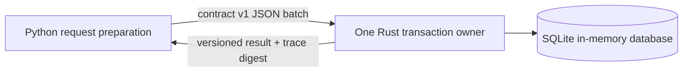

# Dual-Language Seam Proof of Concept

**Run date:** 2026-10-24
**Host:** Windows, CPython 3.13.3, rustc/cargo 1.91.1
**Purpose:** Check that Python and Rust implementations can preserve the same
atomic operation contract, and estimate the effect of crossing a serialized
language boundary at different transaction sizes.

## Toy workflow

The prototype is independent of Kogwistar. It transfers cents between 32
in-memory SQLite accounts using one deterministic 2,000-transfer trace. Each
batch is one transaction. It compares:

1. Python generates the trace and owns SQLite transactions.
2. Rust generates the trace and owns SQLite transactions in a persistent Rust
   process.
3. Python generates the trace and sends each atomic batch as one versioned JSON
   line to the persistent Rust process. Rust alone owns the connection and
   applies the entire batch transaction.

The same modes run with transaction sizes of 1, 32, and 256 transfers. The
JSON-line mode therefore makes 2,000, 63, and 8 Rust calls respectively. This
demonstrates why the language seam belongs around an atomic capability or
batch, rather than around every low-level operation.



The database connection never crosses the seam. The Rust owner receives a
bounded command, validates and applies it in one transaction, then returns a
result. The benchmark checks total balances, transfer count, and an ordered
ledger digest. A deliberately invalid batch must leave both implementations'
state unchanged.

## Results

Warm-up is one run per mode/transaction size and is excluded from the table.
Each reported value is the median of five measured runs. Rust process startup
and compilation are outside the operation timings. The first Rust process
startup observed was 360.7 ms; subsequent starts in this same run were about
20 ms. The initial clean offline Rust build took about 64 seconds; a subsequent
incremental build took 2.0 seconds. Build time is toolchain/cache setup, not
request latency.

| Transfers per transaction | Calls across seam | Python native (ms) | Rust native (ms) | Python to Rust JSONL (ms) |
| ---: | ---: | ---: | ---: | ---: |
| 1 | 2,000 | 84.9 | 43.1 | 397.6 |
| 32 | 63 | 60.1 | 30.9 | 56.7 |
| 256 | 8 | 61.7 | 32.8 | 44.0 |

All three paths produced identical account balances, total cents, transfer
count, and ordered ledger digest for each transaction size. Both Python and
Rust rolled back a batch containing a valid transfer followed by an invalid
account reference. The harness exited successfully with `parity: PASS` and
`atomic_rollback_parity: PASS`.

## Reverse Rust-to-Python seam

The same persistent Rust process can request a bounded Python step using a
versioned JSONL callback envelope. For this proof, Python uses NumPy to compute
the mean and L2 norm of 4,096 numbers. Rust checks the contract version, event
kind, callback correlation ID, and numeric result shape before completing the
request. A deliberately mismatched correlation ID is rejected. One callback
warm-up is excluded per worker session; the following values are the average
round-trip latency over 25 callbacks, across the three worker sessions used by
the transaction-size suite:

| Worker session associated with transaction batch size | Mean Rust -> Python -> Rust round trip |
| ---: | ---: |
| 1 | 14.0 ms |
| 32 | 15.1 ms |
| 256 | 13.5 ms |

The transaction batch size does not affect this callback payload; the three
rows are repeated sessions, not a claim that callback latency scales with
transaction size. These measurements include JSON serialization, pipe I/O,
and NumPy work, on this one Windows host. The worker is kept alive across calls.
No SQLite transaction is open during Python execution. A production design
should dispatch Python-only steps as separately claimed worker jobs, or place
the seam around a sufficiently coarse operation. It must not hold a database
transaction open while waiting for an arbitrary callback.

This toy reverse callback is not the production Kogwistar worker protocol.
Kogwistar already has a Rust-owned runtime authority with Python sync/async
workers in `kogwistar/runtime/rust_runtime_authority.py` and
`kogwistar/runtime/rust_worker.py`; those workers claim committed work, execute
the Python resolver outside the Rust store transaction, journal the restricted
result, and submit it for Rust validation/persistence. That implementation is
not the same as arbitrary callbacks from the standalone Rust HTTP server, whose
runtime/server cutover remains incomplete. See core ADR-022 for the distinction
and its remaining verification gate.

At one transfer per call, the process JSON seam made the mixed path about 4.7x
slower than Python and 9.2x slower than Rust in this toy. With batches of 32,
the mixed path was close to Python's total time; with 256, its latency was
about 0.71x Python's and 1.34x Rust's. Rust's in-memory SQLite path was faster
than Python's in these runs, but this toy does not isolate language runtime
costs from SQLite bindings, SQL execution, generation, and driver behavior.

## What this establishes

- A versioned serialized seam can preserve a complete atomic write operation
  while keeping the connection and transaction inside the owning language.
- Python and Rust implementations can produce equivalent durable-state
  projections from the same deterministic workload.
- Crossing frequency matters substantially. Sending one whole transaction
  batch is much cheaper than sending one command per transfer.
- A mixed deployment remains feasible when the capability contract defines
  transaction ownership, input validation, result shape, and failure behavior.

## What this does not establish

- These numbers are not production or Kogwistar performance estimates. The
  database is in memory, the workload is small, and this is one Windows host.
- It does not test disk-backed SQLite, PostgreSQL, concurrent transactions,
  PyO3 call overhead, or production Kogwistar worker performance. The two toy
  mixed-language directions use JSONL over a local persistent process.
- Rust's native path runs the trace generation and transaction loop in Rust;
  Python's path runs both in Python. The benchmark includes that difference,
  so it is an end-to-end toy comparison rather than an isolated SQL benchmark.
- The batch-size rows have different commit boundaries. Compare languages
  within a row; do not interpret differences between rows as a pure seam cost.
- The startup observations are too few for a startup performance conclusion.

## Conclusion for ADR-022

The high-level design is feasible: keep both language implementations, select
at a capability boundary, and let the selected implementation own each atomic
transaction. A native path can avoid internal language handoffs when a measured
workload benefits. The toy also shows that a fine-grained worker protocol can
erase implementation gains, so production seam granularity must follow the
transaction and workload contract.

This is a feasibility result only. The next meaningful validation is a
resource-matched Kogwistar vertical slice over disk-backed SQLite and
PostgreSQL, with the same contract and operation trace, followed by separate
PyO3 and worker-boundary measurements if those seams are candidates.

## Reproduction

From the repository root:

```powershell
python experiments/dual_language_seam_poc/run_poc.py
```

The harness builds the standalone Rust owner with Cargo offline, runs the
parity and rollback checks, performs warm-up and measured samples, then prints
the raw result JSON. The Rust build output is ignored under the experiment's
`target/` directory.
