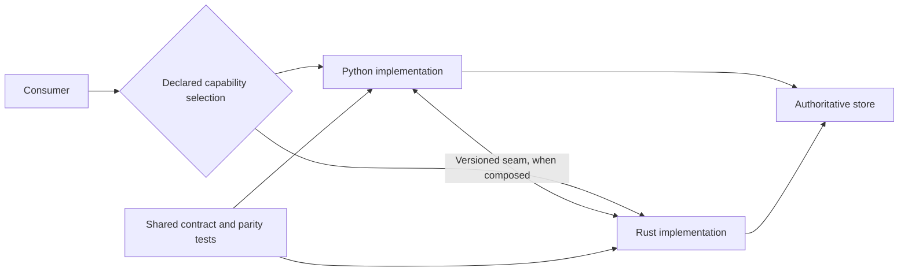

# Kogwistar Rust Port: Consumer Compatibility Reminder

> **Current architecture authority:** This document is a consumer-compatibility
> inventory, not the current language-selection strategy. Its original
> Python-facade-only framing has been superseded by
> [ADR-022: Dual-Language Capability Paths](../kogwistar/kogwistar/docs/ADR-022-dual-language-capability-paths.md)
> and the companion checklist. Keep the compatibility safeguards below, but
> do not use this document to require Rust to remain hidden behind Python or
> to make Python the only rollback target.

## Purpose

This is a consumer-compatibility inventory for changes to `kogwistar` core.
Any selected implementation must preserve the consumer contracts below;
compiling Rust code or matching a subset of core unit tests is not sufficient.

- `kogwistar-llm-wiki` composes the system and owns product policy.
- `kg-doc-parser` emits grounded, graph-ready extraction artifacts and uses
  Kogwistar runtime, model, ID, and source-pointer helpers.
- `kogwistar-obsidian-sink` materializes a human-facing, deterministic vault
  projection from Kogwistar-shaped graph data.

This document supplements, rather than changes, the ownership rules in
[`repo_boundary_and_contract_catalog.md`](repo_boundary_and_contract_catalog.md)
and the concrete integration surface in
[`inter_repo_api_and_event_catalog.md`](inter_repo_api_and_event_catalog.md).

Historical Python reference facts, fixture requirements, backend safeguards,
and evidence commands captured before implementation are in
[Kogwistar Rust Port: Pre-Migration Baseline and Evidence Plan](kogwistar_rust_port_pre_migration_baseline.md).

## Decision Rule

Follow ADR-022 for implementation selection: Python and Rust remain supported
implementations, a deployment may select either at a declared capability
boundary, and a composed path may cross languages only through an explicit,
versioned seam. A seam-free native path in either language is an optional
optimization, not the only supported architecture.

The compatibility requirements below still apply to existing Python
consumers, Python imports, wire contracts, and stored data. They do not require
Rust to be hidden behind a Python facade. Before promoting a Rust capability,
prove its parity and a safe return to the Python implementation where that
capability shares data or durable contracts; do not imply that every deployment
must route through Python.

## Non-Negotiable Compatibility Invariants

### Canonical data and provenance

- Keep `Node`, `Edge`, `Document`, `Grounding`, `Span`, and graph extraction
  payloads structurally compatible at the Python boundary, including
  `model_validate` / `model_dump` behavior used by consumers.
- Preserve stable IDs, field meanings, defaulting rules, serialization shapes,
  and ordering where output is intentionally deterministic.
- Preserve provenance as mandatory domain data: source references, grounding,
  character offsets, and mention spans must not be silently dropped or
  weakened during Rust/Python conversion.
- Preserve append-only and tombstone semantics. An update, replacement, or
  deletion must not become a silent in-place overwrite merely because the new
  backend makes one convenient.

### Engine and storage behavior

- Preserve `GraphKnowledgeEngine`, its `read`/`write` surfaces, scoped
  namespace behavior, graph-space filtering, and close/cleanup semantics used
  by the app.
- Preserve observable read/write/query behavior: workspace isolation,
  namespaces, node/edge/document lookup, endpoint references, filtering,
  deterministic rebuild inputs, and error categories.
- Keep the existing backend promises distinct. In particular, do not claim
  PostgreSQL-style transactional guarantees for Chroma or alter Chroma's
  single-writer operating assumptions as an incidental result of the port.
- Treat existing Chroma, SQLite, and Postgres/pgvector data formats as
  production compatibility surfaces. Do not auto-migrate, re-index, compact,
  or mutate an existing store on first Rust-backed startup. Migration must be
  explicit, backed up, resumable, and reversible.

### Runtime, events, and operational state

- Preserve workflow run status, suspension/resume, retry, checkpoint, job,
  budget-attribution, and recovery semantics that downstream orchestration
  observes.
- Preserve event ordering, cursor/sequence semantics, idempotency, and
  payload fields. Do not rename or replace recognized CDC envelopes (including
  the sink's current `entity.upsert` input) without a versioned compatibility
  adapter that both old and new consumers can run.
- Map Rust errors to the established Python exception/result contract. Raw FFI,
  transport, or Rust-only error text is not an application contract.

### Dependency direction

- Keep graph truth, events, generic runtime behavior, and reusable primitives
  in `kogwistar`.
- Do not move llm-wiki promotion/lane/maintenance policy, parser source-map
  policy, or Obsidian rendering/path policy into Rust core just to simplify the
  port.
- A Rust RPC boundary is not a reason for the parser or sink to mutate graph
  storage directly; the integration modes in the inter-repo catalog remain in
  force.

## What Each Consumer Must Continue To Do

| Consumer | Current dependency on Kogwistar | Release-blocking outcome |
| --- | --- | --- |
| `kogwistar-llm-wiki` | Core models, `GraphKnowledgeEngine`, in-memory and persistent engines, namespace-scoped reads/writes, IDs, logical refs, runtime workflows, budgets, maintenance and policy helpers | A document can ingest, promote, resume/recover, query, and rebuild an Obsidian vault without crossing workspaces or graph spaces. |
| `kg-doc-parser` | `Node`/`Edge`/`Grounding`/`Span`, workflow runtime and run results, retry helpers, stable IDs, source-pointer validation, and fuzzy-offset utilities | The parser produces the same validated, grounded output and can run its workflow/retry paths without changing parser-owned semantics. |
| `kogwistar-obsidian-sink` | Kogwistar-shaped entity data and CDC envelopes; llm-wiki supplies scoped node/edge snapshots before the sink builds notes | Incremental projection and a full rebuild yield the same stable note identities, relationships, links, and drift behavior for the same authoritative graph snapshot. |

The sink is intentionally tolerant of a Kogwistar-like object, but that is not
permission to degrade fields. Its projection adapter reads IDs, labels/types,
summaries, metadata, mentions, source/target IDs, relationships, and bodies.
Those fields are visible user data once written into an Obsidian vault.

## Required Port Stages

### 1. Freeze and describe the Python contract

Before replacing any implementation path:

- Inventory public imports and runtime entrypoints actually used by all three
  consumers. Start with the imports in their source and tests; do not define
  the Rust boundary from the core package alone.
- Record JSON fixtures for canonical model round trips, graph reads, CDC/event
  envelopes, workflow states, errors, and a representative projection snapshot.
- Write a compatibility manifest that names every supported symbol, method,
  request/response schema, and event version. Mark each item as preserved,
  adapter-backed, deprecated, or intentionally deferred.
- Establish a semantic-version and deprecation policy before any incompatible
  change is introduced.

### 2. Add the compatible facade before switching behavior

- Keep existing Python imports valid, including `kogwistar.engine_core`,
  `kogwistar.engine_core.models`, `kogwistar.runtime`, `kogwistar.id_provider`,
  and source-pointer/fuzzy-offset utility modules consumed today.
- Convert only at the facade boundary; do not leak Rust-native object types,
  bytes, timestamps, enum spellings, unordered maps, or exceptions into
  consumer code.
- Prefer typed conversion layers and schema validation at that boundary. The
  conversion code is part of the public compatibility implementation and must
  have tests of its own.
- Keep a feature flag or explicit backend selection that selects Python versus
  Rust behind the same facade. The default must remain conservative until the
  parity gates below pass.

### 3. Prove dual-run parity

For fixed inputs, run the Python and Rust-backed facades independently and
compare normalized outputs. Compare semantics, not incidental timestamps or
implementation-specific diagnostics.

Required comparisons include:

- canonical model validation and serialization;
- stable IDs and provenance/offset retention;
- graph query results under workspace, namespace, and graph-space filters;
- append/update/tombstone event streams and replay;
- workflow completion, suspension, retry exhaustion, and recovery state;
- parser output to graph ingestion;
- Obsidian snapshot plus deterministic full-vault rebuild.

Any expected difference needs an approved compatibility-manifest entry, a
consumer adapter if relevant, regression coverage, and a migration/release
note. "Rust behavior is more correct" is not sufficient justification for a
silent difference.

### 4. Canary, then promote a capability

- Start with new, disposable workspaces and a non-destructive shadow/read-only
  comparison path for existing data.
- For a persistent canary, use explicit per-run roots and never point the
  Python and Rust implementations at a single-writer Chroma store at the same
  time.
- Capture event sequence, checkpoint/recovery status, graph counts and IDs,
  projection manifests, generated vault hashes, and error classifications.
- Promote the selected implementation only after clean repeated canaries, an
  exercised compatible handoff/rollback where applicable, and the consumer
  suites below pass for the named capability and backend.

## Minimum Release Gate

These are compatibility evidence gates for promoting a Rust implementation of
the covered capabilities. They do not impose a single global implementation
default; Python and Rust remain supported under ADR-022.

- [ ] Existing satellite imports work unchanged in a clean environment.
- [ ] Shared contract fixtures pass for both Python and Rust implementations,
      including any declared facade or transport seam.
- [ ] `kogwistar-llm-wiki` unit and integration coverage passes, including
      ingest, workspace isolation, long-run/recovery, and projection
      consistency paths.
- [ ] `kg-doc-parser` workflow/grounding/fuzzy-offset/retry coverage passes.
- [ ] `kogwistar-obsidian-sink` event-consumer, deterministic projection,
      round-trip, and full rebuild coverage passes.
- [ ] A cross-repo end-to-end fixture passes:
      source -> parser -> graph ingest -> event/projection -> Obsidian vault;
      then replay/rebuild the same vault from authoritative state.
- [ ] The end-to-end fixture includes an update and a tombstone, not only a
      create path.
- [ ] A checkpointed or interrupted workflow resumes correctly after a
      process restart.
- [ ] A same-version data store is readable by the selected implementation,
      and an explicit migration/rollback rehearsal is recorded for every
      format that is changed.
- [ ] Rollback to the Python implementation is demonstrated with the canary
      data intact and without event duplication or projection corruption.
- [ ] Release notes list the core version, facade/contract version, supported
      backends, storage migration status, and the exact satellite versions
      tested together.

## Questions That Must Be Answered in the Rust Port Plan

1. What remains in Python during the first release, and why is its boundary
   stable for all current consumers?
2. Is the Rust integration in-process or out-of-process? If out-of-process,
   what is the versioned protocol, authentication/configuration model, timeout
   behavior, and offline/local-developer story?
3. Which storage backend is ported first? What are the read compatibility,
   write compatibility, migration, backup, and rollback guarantees for it?
4. How are Python `Node`/`Edge`/provenance models validated and converted at
   the boundary without changing their semantic meaning?
5. How will event sequence/cursor, idempotency, and tombstone behavior be
   verified against the current consumer expectations?
6. What is the planned compatibility window for the current Python facade,
   and who owns each resulting contract test?

## Explicit Non-Goals for the First Port

- Rewriting `kogwistar-llm-wiki`, `kg-doc-parser`, or
  `kogwistar-obsidian-sink` into Rust.
- Combining parser, product, or vault-projection policy into Kogwistar core.
- Changing graph schema, ID policy, event semantics, storage format, and
  runtime behavior in one unversioned release.
- Treating a successful new-store demo as proof that existing user data,
  recovery state, or dependent repositories are safe.

## Ownership

The Kogwistar Rust-port owner owns the compatible core facade, backend/runtime
parity, storage migration/rollback, and core contract tests. Each satellite
owner owns its product-specific acceptance fixtures. The coordinated release
owner must require the end-to-end gate before making Rust the default.
